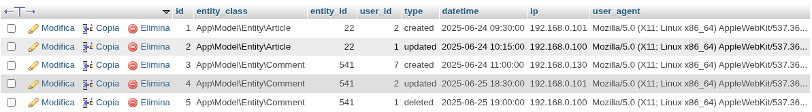

# cakephp-entities-logger

[](LICENSE.txt)
[](https://github.com/mirko-pagliai/cakephp-entities-logger/actions/workflows/ci.yml)
[](https://codecov.io/gh/mirko-pagliai/cakephp-entities-logger)
[](https://app.codacy.com/gh/mirko-pagliai/cakephp-entities-logger/dashboard?utm_source=gh&utm_medium=referral&utm_content=&utm_campaign=Badge_grade)
[](https://www.codefactor.io/repository/github/mirko-pagliai/cakephp-entities-logger)



From this screenshot, which shows the table seen by PhpMyAdmin, we see the logs generated by two different entities,
created, modified or deleted by different users.

## Installation
You can install the plugin via composer:
```bash
composer require --prefer-dist mirko-pagliai/cakephp-entities-logger
```

Then you have to load the plugin. For more information on how to load the plugin,
please refer to the [CakePHP documentation](https://book.cakephp.org/5/en/plugins.html#loading-a-plugin).

Simply, you can execute the shell command to enable the plugin:
```bash
bin/cake plugin load Cake/EntitiesLogger
```
This would update your application's bootstrap method.

## Create the table
Now you need to create the table that the plugin will use to keep changes to the entities you want.

The best way is using migrations:
```bash
bin/cake migrations migrate -p Cake/EntitiesLogger
```

Instead, if you want to verify that the plugin migrations have been applied correctly:
```bash
bin/cake migrations status -p Cake/EntitiesLogger
```

## Add the behavior

Add the `Cake/EntitiesLogger.EntitiesLog` behavior to the tables you want.

Inside the `initialize()` method of your tables:
```php
namespace App\Model\Table;

use Cake\ORM\Table;

class ArticlesTable extends Table
{
    public function initialize(array $config): void
    {
        // ...
        
        $this->addBehavior('Cake/EntitiesLogger.EntitiesLog');
        
        // ...
    }
}
```

## Options

The behavior accepts the following options:
```php
$this->addBehavior('Cake/EntitiesLogger.EntitiesLog', [
    'checkRules' => true,
    'mergeInterval' => 300,
]);
```

* `checkRules` (default `true`): whether the rules of `EntitiesLogsTable` are checked when the log is saved (for
  example, that the user exists). With `false`, the rules are not checked;
* `mergeInterval` (default `300`): the interval, in seconds, within which close updates are merged into a single log.
  With `0`, the updates are not merged and every change is logged. See below.

## Merging close updates

A user who changes the same entity several times in a short time (for example, it is saved, a mistake is noticed and it is
saved again) would leave a log for each change. For this reason, when an entity is updated, a new log is not added if
the **last** log of that entity:

* is an `Updated` log (the `Created` and `Deleted` logs are never merged);
* was made by the same user, from the same IP address and with the same user agent;
* is not older than the `mergeInterval` option (300 seconds, 5 minutes, by default).

In this case the `datetime` of that log is updated, so the log always shows the time of the last change. Nothing else is
written or deleted.

Some things to keep in mind:

* only the last log is considered: if another user has changed the entity in the meantime, a new log is added, so that
  the history is kept (the changes of A, B and then A again are three logs);
* the interval is counted from the last log, not from the first change. If the same user keeps changing the entity, and
  never leaves more than the interval between two changes, only one log is kept;
* the logs that already exist are not modified.

## Requests and identity

The log stores the user who made the change, so it is created only when there is a request:

* when there is no current request (for example, in a shell command or in a cronjob), nothing is logged, and the entity
  is saved or deleted as usual;
* when there is a request, but it has no `identity` attribute (for example, the user is not authenticated), or the
  identity has no `id`, an exception is thrown when the entity is saved or deleted and the changes are rolled back, so
  that a change without an author is never saved silently.

## Supported primary keys

The `entity_id` column of the `entities_logs` table is an integer. For this reason, the tables that load the behavior
must have a single-column primary key (it doesn't have to be named `id`) whose value is an integer.

If the primary key is composite or its value is not an integer (for example, a UUID), the log cannot be saved and an
`UnexpectedValueException` is thrown when the entity is saved or deleted.

The same applies to the identity stored in the request (the user), whose `id` must be an integer.

## Entity class

The logs of an entity are identified by the `entity_class` and `entity_id` columns, and the `EntitiesLogs` association
added by the behavior finds the logs whose `entity_class` is exactly the entity class of the table. For this reason,
the logs of entities of other classes (even subclasses) are not found.

The entity class must identify the table: each table that loads the behavior must have its own entity class. Tables
that share the same entity class would also share the logs (the same `entity_id` of two tables would be mixed up), so
the generic `Cake\ORM\Entity` class, which CakePHP uses when a table has no entity class of its own, is not accepted:
an `UnexpectedValueException` is thrown when the entity is saved or deleted.

## IP address

The IP address is taken from `ServerRequest::clientIp()`. If the application is behind a proxy or a load balancer, the
request must trust it (`ServerRequest::$trustProxy`), otherwise the address of the proxy is logged instead of the one of
the client.

## Logs on a different connection

The log is saved in the `afterSave()` and `afterDelete()` callbacks of the table that loaded the behavior, so inside the
transaction of the entity being saved or deleted.

If you store the logs on a different connection (for example, with your own `EntitiesLogsTable` that overrides
`defaultConnectionName()`), the two cannot be rolled back together: if the transaction is rolled back after the log has
been written (for example, when the save is part of a larger transaction), the log is kept.

In this case, the plugin migrations must be run on that connection too (here `logs`), otherwise they would try to modify
the `entities_logs` table of the default connection, which doesn't exist:
```bash
bin/cake migrations migrate -p Cake/EntitiesLogger -c logs
```

The `afterSaveCommit()` and `afterDeleteCommit()` callbacks are not used, because CakePHP does not dispatch those
events when the save is part of a larger transaction, and the log would be lost.
